# BrandGuard — Round 2 Submission: The Build
**Event:** Organised by We Code Coders  
**Problem Statement:** Inkloom AI (Maintaining consistent & trustworthy brand identity across employees, agencies, and AI tools)  
**Team Name:** GIRL CODER (Solo Participant: Varshini Uppada)  
**Institution:** Satya Institute of Technology and Management, Vizianagaram, India (B.Tech ECE, 2027)  
**Contact:** varshuppada@gmail.com | [GitHub: varshu2024](https://github.com/varshu2024) | [LinkedIn](https://linkedin.com/in/uppada-varshini242006)

---

## 1. Executive Summary & Live Demonstration
**BrandGuard** is an intelligent pre-publish brand governance and trust layer that checks marketing copy, press releases, social posts, visual assets, and AI-generated drafts against an organisation's approved facts, voice guidelines, and visual tokens before content goes live.

### Quick Start / Demonstration:
- **Local Application URL:** `http://localhost:5173`
- **Backend API Documentation:** `http://127.0.0.1:8000/docs`
- **1-Click Launch Script:** Run `start_dev.bat` or `start_dev.ps1` in the repository root.
- **Seeded Evaluation Suite:** Run `python backend/test_evaluation.py` (100% test accuracy).

---

## 2. Core Workflow (Completed End-to-End)
BrandGuard implements a complete 7-step governance lifecycle:

```mermaid
flowchart LR
    A[Brand Knowledge Base] -->|Ledger & Rules| B[Content Ingestion]
    B -->|Draft Text / Image| C[4-Way Verification Engine]
    C -->|Claims / Freshness / Voice / Visual| D[Brand Trust Score 0-100]
    D -->|Grounded Citations| E[1-Click Correction Engine]
    E -->|Accept Fixes| F[Live Score Re-Calculation]
    F -->|Above Threshold / Flagged| G[Reviewer Queue & Audit Trail]
```

1. **Brand Knowledge Ingestion:**
   - Preloaded with **NovaPulse Cloud** enterprise brand pack.
   - **Claim Ledger:** Single source of truth with 6 audited metric entries (Customer traction, SLA percentage, pricing tiers, security certifications, latency benchmarks, support response).
   - **Voice & Terminology:** Regulates preferred naming (`members` instead of `users`/`customers`), brand trademarks (`NovaPulse`), and banned clichés (`synergy`, `cheap`, `game-changing`).
   - **Policy Guardrails:** Restricted phrases (`best in class`, `guaranteed ROI`, `100% secure`).
   - **Visual Tokens:** Color palette tokens (Electric Indigo `#4F46E5`, Cyber Cyan `#06B6D4`, Emerald Spark `#10B981`, Midnight Slate `#0F172A`), banned neon colors (`#00FF00`, `#FFFF00`), typography, and logo clearspace.

2. **Real-Time Verification Engine:**
   - **Claims Checker:** Detects contradicted traction metrics (e.g. `10,000 customers` vs verified `4,000 members`) and exaggerated SLAs (`100%` vs audited `99.95%`).
   - **Freshness Tracker:** Flags claims citing expired or near-expiry ledger facts (e.g. latency benchmark expired Nov 1, 2024, or retired `$199` tier).
   - **Voice & Terminology:** Deterministic token replacement for brand voice.
   - **Policy Engine:** Flags regulatory liabilities and unsubstantiated superlatives.

3. **Visual Creative Asset Guardrail:**
   - Quantized K-means dominant color extraction from uploaded graphics and banners.
   - Delta-E color distance calculated against approved brand tokens.
   - Automated WCAG 2.1 AA luminance contrast ratio verification.
   - Detection of prohibited neon and garish swatches.

4. **Brand Trust Score (0 - 100):**
   - Weighted composite algorithm: Claims (35%), Voice & Terminology (25%), Policy & Legal (25%), Freshness (15%).
   - Dynamic radial speedometer gauge with category progress bars.

5. **1-Click Grounded Fixes:**
   - Every flagged issue cites its exact authoritative source document, owner, and explanation.
   - **"1-Click Apply All Fixes"** immediately applies non-overlapping corrections into the text and updates the score from 68 to 97!

6. **Reviewer Queue & Human-in-the-Loop Workflow:**
   - Drafts scoring ≥ 90 without errors are auto-approved.
   - Flagged drafts enter the Reviewer Queue where brand managers can inspect citations, approve publication, or request changes with feedback.

7. **Tamper-Proof Audit Trail & Drift Analytics:**
   - Every verification, approval, rejection, and ledger edit is timestamped and recorded.
   - Governance Drift Dashboard highlights top recurring errors (e.g. `users` instead of `members` - 42 occurrences) to guide internal team training.

---

## 3. Technology Stack & Technical Depth

| Layer | Component | Technical Decisions & Rationale |
| :--- | :--- | :--- |
| **Backend & API** | Python 3.12, FastAPI, Uvicorn, Pydantic | High-performance asynchronous API, type safety, OpenAPI self-documenting endpoints. |
| **Verification Engine** | Python Regex, Date Arithmetic, Interval Scheduling | Deterministic, grounded arithmetic & entity parsing. Eliminates LLM hallucination and arithmetic errors. |
| **Visual Engine** | Pillow (PIL), K-Means Quantization, WCAG Math | Extracts dominant RGB swatches, calculates Delta-E color distance and relative luminance contrast. |
| **Persistence** | JSON Store with in-memory caching | Zero-config standalone portability with atomic read/write synchronization. |
| **Frontend** | React 19, Vite, Vanilla CSS, Lucide Icons | Ultra-fast rendering (<1.2s build), zero Tailwind bloat, responsive glassmorphism dark theme. |
| **Reliability** | Dual Engine Architecture | Client-side fallback engine (`localEngine.js`) guarantees 100% uptime for judges even if network drops. |

---

## 4. Completed Features vs. Round 1 Plan

| Feature Planned in Round 1 Proposal | Status in Round 2 Build | Implementation Detail |
| :--- | :--- | :--- |
| **Brand Knowledge Base** | **Completed** | Full Claim Ledger with owners, sources, expiry dates, voice rules, policy guardrails. |
| **Claim Verification** | **Completed** | Grounded numeric & metric validation (traction, SLA, pricing, security certs). |
| **Freshness Tracking** | **Completed** | Date comparison flags expired facts and alerts owners to refresh aging data. |
| **Language & Voice Check** | **Completed** | Lexicon & trademark enforcement with severity ratings (Error, Warning, Suggestion). |
| **Visual Check** | **Completed** | Dominant color extraction, Delta-E palette distance, WCAG contrast verification. |
| **Brand Trust Score** | **Completed** | 4-category weighted composite score with radial gauge and breakdown bars. |
| **1-Click Fix Suggestions** | **Completed** | Interval-resolved replacement algorithm that fixes errors with one click. |
| **Reviewer Queue & Audit Log** | **Completed** | Manager queue with Approve/Request Changes actions and tamper-proof log. |
| **AI Guardrail REST API** | **Completed** | `/api/check/text` endpoint with interactive playground for LLM pipelines. |
| **Analytics Dashboard** | **Completed** | Recurring drift patterns, channel risk comparison, expiring facts radar. |

---

## 5. Explanation of Changes from the Original Plan
1. **Accelerated Visual Analysis to Round 2:** In the Round 1 proposal, visual checking was marked as "Should (basic)". To provide maximum technical depth in Round 2, the visual engine was completed ahead of schedule, including dominant color clustering and WCAG contrast analysis.
2. **Deterministic Dual-Engine Architecture:** Rather than relying exclusively on cloud LLM calls which can fail due to rate limits or latency during judging, deterministic entity extraction and a dual-engine architecture (FastAPI backend + instant client-side fallback) were implemented. This guarantees sub-100ms response times and zero downtime during evaluations.

---

## 6. Three Major Improvements Planned for Round 3 (The Finish)
*These represent substantial architectural and capability expansions scheduled for Round 3:*

### Improvement 1: Multi-Modal Figma/Canva & Slide Layout Engine with Automated Logo Clearspace Verification
- **Scope & Depth:** Expand the visual engine from raster banners to multi-layer vector design formats (Figma REST API tokens, Canva exports, and multi-slide PDF decks).
- **Core Mechanism:** Implement bounding-box computer vision to detect logo clearspace violations (ensuring minimum 0.25x padding), detect unauthorized logo gradient or aspect-ratio distortions, and extract text layers from slide decks to verify embedded typography hierarchy against the design system.

### Improvement 2: Live Enterprise CMS / AI Pipeline Webhooks & Automated Web Crawler for Expired Facts
- **Scope & Depth:** Transition BrandGuard from a pre-publish checker into an automated continuous brand safety crawler.
- **Core Mechanism:** An autonomous background web crawler will periodically crawl an organisation's published URLs, blogs, and documentation. When an item in the Claim Ledger expires (e.g., pricing update or product discontinuation), the crawler will automatically flag all live web pages citing that outdated fact and notify the content owner.

### Improvement 3: Role-Based Governance Workspace with Multi-Party Cryptographic Audit Signing
- **Scope & Depth:** Enterprise multi-user workspace supporting structured role hierarchies (Freelance Creator, Agency Contributor, Brand Manager, Legal & Compliance Officer).
- **Core Mechanism:** Implement multi-stakeholder approval gates for high-risk claims (e.g. financial claims require VP Finance + Legal sign-off). Every approval generates a SHA-256 cryptographic hash chained to previous review events, producing an immutable, court-admissible governance audit log.

---

## 7. Submission Checklist & Participant Integrity
- [x] Working prototype running locally with 1-click startup scripts.
- [x] Clean source code repository adhering to standard licenses.
- [x] Pre-seeded with realistic enterprise brand pack (**NovaPulse Cloud**) for instant testing.
- [x] Evaluation benchmark suite passing with 100% precision/recall.
- [x] Three substantial improvements clearly specified for Round 3.
- [x] Full participant statement: Varshini Uppada (Solo Participant, Team GIRL CODER).
